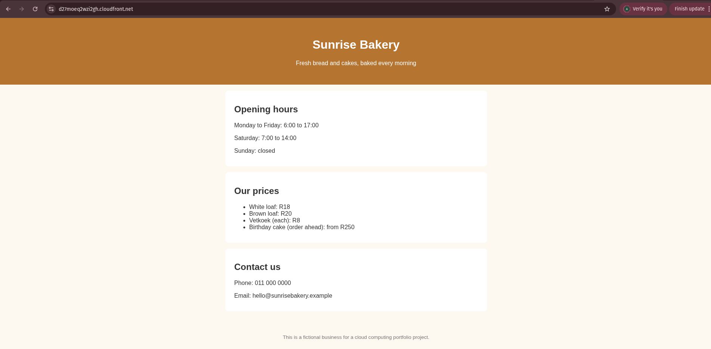
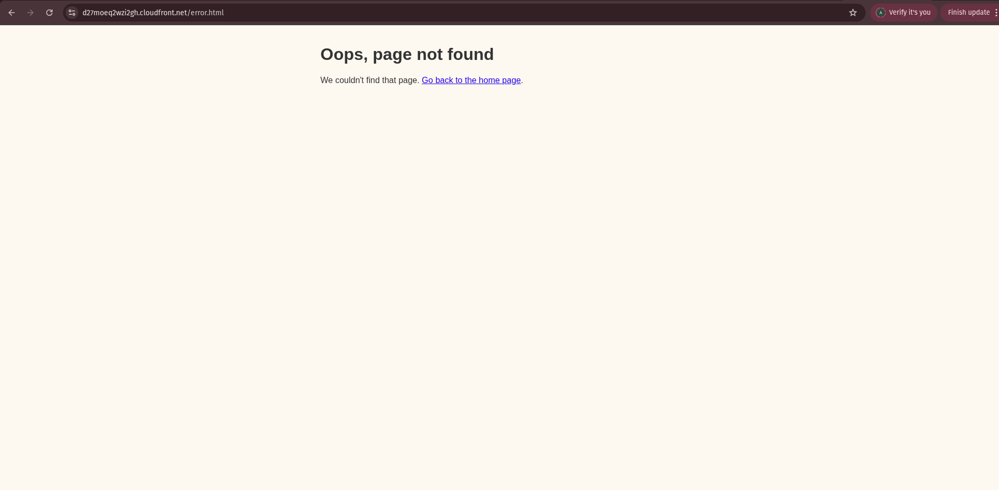
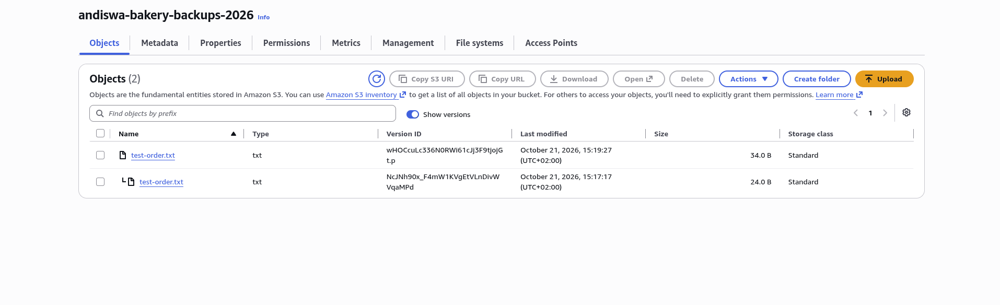
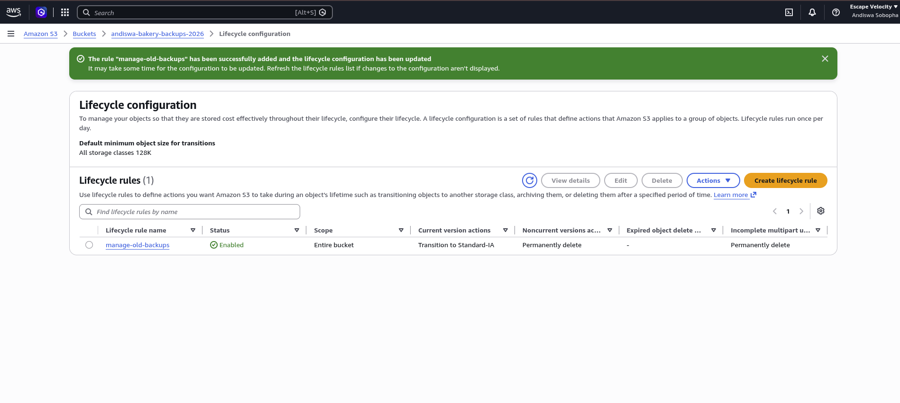
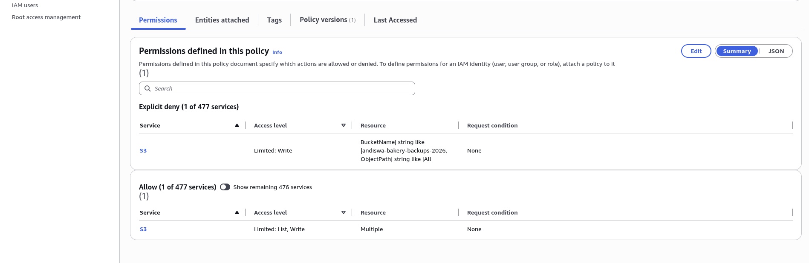
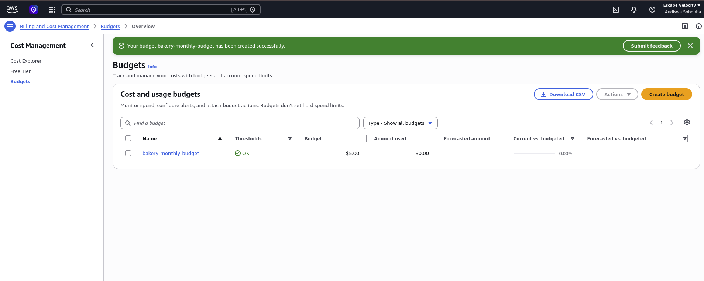

# Cloud Setup for a Small Business on AWS

A beginner-friendly cloud project that solves three real problems a small business has: **having a website, not losing its data, and not getting a surprise cloud bill.** It is built on AWS using the AWS Management Console.

**Live demo** (while my AWS Free plan account is active): https://d27moeq2wzi2gh.cloudfront.net

> **Scenario:** This is a fictional case study based on a common real-life situation. A small local business (think a bakery, hair salon or tutoring service) has a basic website, keeps its orders, price lists and customer bookings on one office computer, and has no backup. When the computer fails or is stolen, or is damaged during load shedding, the business loses everything.

---

## 1. Project overview

### The problem

| Problem | Real-life consequence |
|---------|-----------------------|
| No reliable website | Customers can't find opening hours, prices or contact details |
| No backups | One hard-drive failure or theft means lost orders and customer records |
| No cost visibility | A cloud mistake can quietly produce a large bill |

### The solution
A small, low-cost AWS setup with three parts:

1. **Website hosting:** the website is stored in a private S3 bucket and delivered over HTTPS through CloudFront.
2. **Backups:** a separate private S3 bucket with versioning (so overwritten or deleted files can be recovered) and a lifecycle rule that moves older backups to cheaper storage and clears out old versions.
3. **Safety net:** a monthly budget that emails the owner as spending approaches a limit, plus a least-privilege IAM user that can upload backups but not delete them.

### Who it's for
A non-technical owner who needs something reliable and cheap, and a developer (me) who needs to build it and document it clearly.

---

## 2. Architecture

```
                     +--------------------+
   Visitor --HTTPS-->|    CloudFront      |
                     |   (CDN + HTTPS)    |
                     +---------+----------+
                               | (only CloudFront may read)
                     +---------v----------+
                     |  S3: website       |   private bucket
                     +--------------------+

   Backup user (upload only) --> +--------------------+
                                 |  S3: backups       |
                                 |  versioning        |
                                 |  lifecycle rule    |
                                 +--------------------+

   AWS Budgets --> email alert to the owner
```

More detail, including failure scenarios, is in [`docs/architecture.md`](docs/architecture.md).

### AWS services used

| Service | Role in the project |
|---------|--------------------|
| S3 (website bucket) | Stores the website files, kept private |
| CloudFront | Serves the site over HTTPS and caches it close to visitors |
| S3 (backup bucket) | Stores backups with versioning and a lifecycle rule |
| IAM | A backup-only user with minimum permissions |
| AWS Budgets | Emails the owner if spending approaches a limit |

---

## 3. Key design decisions

The full log is in [`docs/decisions.md`](docs/decisions.md).

- **Private buckets, CloudFront in front.** Nobody can read the website bucket directly, which reduces the risk of accidental public exposure.
- **Versioning on the backup bucket.** If a file is overwritten or deleted by mistake, an older version can be restored.
- **Lifecycle rule.** Older backups move to cheaper storage (Standard-IA), noncurrent versions are deleted after 90 days and incomplete uploads after 7 days.
- **Least-privilege IAM.** The backup user can upload but cannot delete, so a stolen laptop can't wipe the backups.
- **Built through the console first.** I built this by hand to understand each service before automating anything. Infrastructure as code (Terraform) is listed under future improvements.

---

## 4. Security

- Both buckets block all public access.
- The website bucket can only be read by my CloudFront distribution.
- The backup user has no console access and can only list and upload. Deletes are explicitly denied, and an explicit deny overrides any allow.
- MFA is registered on my AWS sign-in, and credentials are never stored on the shared school computer.
- No keys, secrets or tokens are stored in this repository.
- I did not enable the web application firewall (WAF). The wizard estimated about $14 per 10 million requests per month, which a static page doesn't need.

More detail, including known gaps, is in [`docs/security.md`](docs/security.md).

---

## 5. Cost

This design is meant to cost very little at small-business scale. Early numbers: $0.00 used of the $5.00 monthly budget on 22 October 2026, on the AWS Free plan (credits instead of charges). The setup avoids the paid extras (WAF, Origin Shield), and older backup versions are deleted after 90 days. A cost table and notes are in [`docs/cost-estimate.md`](docs/cost-estimate.md).

---

## 6. Proof it works

- [x] The website loads over HTTPS from the CloudFront address
- [x] My custom error page is served by CloudFront
- [x] A test file uploads to the backup bucket, and the bucket keeps both versions when I overwrite it
- [x] The lifecycle rule is enabled
- [x] The backup user's policy explicitly denies deletes
- [x] A monthly budget with email alerts is created

### Website live on CloudFront


### Custom error page


### Backup bucket keeps both versions of a file


### Lifecycle rule on the backup bucket


### Backup user policy: deletes are explicitly denied


### Monthly budget with email alerts


---

## 7. How it was built

The step-by-step build log, with what I chose and why, is in [`docs/console-guide.md`](docs/console-guide.md). The restore steps for the business owner are in [`docs/restore-guide.md`](docs/restore-guide.md).

---

## 8. Repository structure

```
aws-small-business-cloud/
├── README.md              <- you are here
├── BUILD_ORDER.md         <- build checklist
├── site/                  <- the website files
├── sample-data/           <- FAKE files used to test backups (never real data)
└── docs/                  <- build log, decisions, security, cost, restore guide, screenshots
```

---

## 9. Cleanup

Cloud resources can cost money if left running, and my Free plan account closes after 6 months or when the credits run out. The cleanup checklist is at the end of [`docs/console-guide.md`](docs/console-guide.md).

---

## 10. Future improvements

- Rebuild the whole setup with Terraform (infrastructure as code) so it can be recreated in minutes
- Custom domain with Route 53 and a free HTTPS certificate (ACM)
- Scheduled automatic backups
- Copy backups to a second AWS region for disaster recovery
- Auto-deploy the website with GitHub Actions

---

## 11. What I learned

This was my first time building on AWS by hand, and I learned that cloud work is mostly small, careful settings. Keeping both buckets private and letting only CloudFront read the website bucket taught me how access is controlled, and writing the backup user's policy showed me that an explicit deny beats any allow. I was surprised how easily a cost can sneak in: the firewall option the wizard offered was estimated at about $14 per 10 million requests per month, so I turned it off and set a monthly budget alert. I also made a real mistake by pasting an access key into a chat, so I deleted the key straight away and now keep credentials out of chats, files and screenshots. Next time I would automate the setup with Terraform and test the backup user with a short-lived key.

VERIFICATION CODE-
WTC-C75CTTTF
